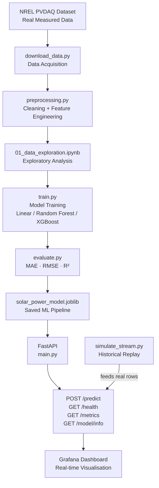
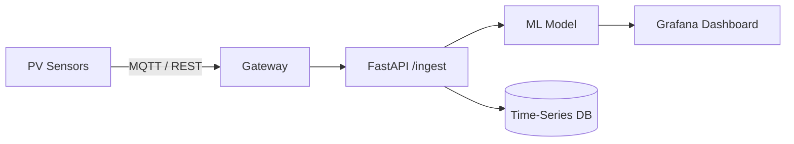

# Solar PV Power Prediction and Monitoring System

A **production-quality, real-world machine learning application** that predicts
photovoltaic (PV) power output from solar irradiance and environmental variables,
built on a genuine measured dataset from the U.S. National Renewable Energy
Laboratory (NREL).

---

## Table of Contents

1. [Project Overview](#1-project-overview)
2. [The Real-World Problem](#2-the-real-world-problem)
3. [Dataset Source](#3-dataset-source)
4. [Architecture](#4-architecture)
5. [Why Regression?](#5-why-regression)
6. [Features and Target Variable](#6-features-and-target-variable)
7. [Data Preprocessing](#7-data-preprocessing)
8. [Model Selection](#8-model-selection)
9. [Evaluation Strategy](#9-evaluation-strategy)
10. [FastAPI REST API](#10-fastapi-rest-api)
11. [Grafana Dashboard](#11-grafana-dashboard)
12. [How to Run](#12-how-to-run)
13. [Making Predictions](#13-making-predictions)
14. [Project Structure](#14-project-structure)
15. [Future Extensions](#15-future-extensions)

---

## 1. Project Overview

This project trains a machine learning model to predict how much electrical
power (in kW) a photovoltaic solar panel system will produce, given current
environmental conditions such as:

- Solar irradiance (how intense the sunlight is)
- Ambient air temperature
- Panel/module surface temperature
- Wind speed

The trained model is exposed through a **FastAPI REST API**, so any system — a
monitoring dashboard, a SCADA system, a mobile app, or a weather-feed integration
— can send current sensor readings and receive a predicted power output in return.

Historical predictions and actual power measurements are visualised in a
**Grafana dashboard**.

## Model Performance

The best performing model is **Random Forest** with the following metrics on the test set:

- **MAE**: 0.0064 kW (average prediction error)
- **RMSE**: 0.0128 kW (root mean squared error)
- **R²**: 0.9976 (explains 99.76% of variance)

The model was trained on 28,108 samples and tested on 7,028 samples from 2012 data.

---

## 2. The Real-World Problem

Solar PV operators and grid managers need to know:

> *"Given current weather conditions, how much power should my solar system be
> producing right now?"*

This answer is valuable for:

- **Performance monitoring**: if the predicted power differs significantly from
  actual measured power, something is wrong (shading, soiling, equipment fault).
- **Grid management**: operators need power forecasts to balance supply and demand.
- **Anomaly detection**: systematic under-production signals maintenance needs.
- **Financial forecasting**: energy yield predictions drive revenue projections.

---

## 3. Dataset Source

**NREL PVDAQ — Site 4 (NREL STR, Golden, Colorado)**

| Property | Value |
|----------|-------|
| Organization | National Renewable Energy Laboratory (NREL), U.S. Dept of Energy |
| Location | Golden, Colorado, USA (39.74°N, 105.17°W) |
| Technology | Multi-crystalline silicon PV, ~2 kW DC |
| Data Period | 2011–2013 (multiple years of 15-minute measurements) |
| Sampling | 15-minute intervals |
| Rows | ~35,000 daytime rows per year |
| License | U.S. Government Open Data (public domain) |
| URL | https://pvdaq.nrel.gov/ |
| API Docs | https://developer.nrel.gov/docs/solar/pvdaq-v3/ |
| OEDI Mirror | https://data.openei.org/submissions/4568 |

This is **real measured data** from physical sensors at an NREL research facility —
not modeled, not synthetic, not of unclear provenance.

See [`DATASET.md`](DATASET.md) for complete provenance documentation.

---

## 4. Architecture



---

## 5. Why Regression?

PV power output is a **continuous numerical value** (e.g., 2.34 kW, 0.87 kW).
Predicting it from environmental inputs is a classic supervised regression problem:

- We have labelled training data (input conditions → measured output)
- The output is continuous, not categorical
- We want to minimise prediction error (MAE, RMSE)

Classification would be inappropriate here — we don't want "high/medium/low" power
bins; we need the actual numeric prediction.

---

## 6. Features and Target Variable

### Target (what we predict)

| Column | Description | Unit |
|--------|-------------|------|
| `power` | AC power output from the inverter | kW |

### Features (model inputs)

| Column | Raw Name | Description | Unit |
|--------|----------|-------------|------|
| `irradiance` | `poa_irradiance` | Plane-of-array irradiance | W/m² |
| `ambient_temperature` | `ambient_temp` | Ambient air temperature | °C |
| `panel_temperature` | `module_temp` | PV module surface temperature | °C |
| `wind_speed` | `wind_speed` | Wind speed | m/s |

Only features **actually present** in the NREL PVDAQ Site 4 dataset are used.
No features are fabricated or imputed from external sources.

---

## 7. Data Preprocessing

The preprocessing pipeline (`src/preprocessing.py`) performs these steps in order:

1. **Parse timestamps** — convert raw datetime strings to `datetime64`
2. **Sort chronologically** — required for time-based train/test split
3. **Remove duplicates** — exact duplicate rows are dropped
4. **Remove physically impossible values** — e.g., irradiance > 1,500 W/m²
5. **Handle negative power** — small negative values from inverter standby are clamped to 0; large negatives signal sensor error and are removed
6. **Handle missing values** — short gaps interpolated; long gaps dropped
7. **Nighttime handling** — rows with irradiance < 5 W/m² are **kept** in the dataset with power ≈ 0. This is physically correct and helps the model learn the zero-power regime. Nighttime rows are flagged with `is_daytime=False` for analysis.
8. **Feature selection** — only columns present in the data are used

**Why keep nighttime data?**
Solar systems produce zero power at night. If we filter nighttime out, the model
never learns this regime. When deployed, the API will receive nighttime requests
(irradiance = 0) and must return ~0 kW, not an erroneous positive value.

---

## 8. Model Selection

Three models are implemented and compared:

| Model | Purpose | Notes |
|-------|---------|-------|
| Linear Regression | Baseline | Assumes linear irradiance–power relationship |
| Random Forest | Non-linear baseline | Captures temperature/irradiance interactions |
| XGBoost | Best expected performer | Gradient boosting handles solar non-linearities well |

A **time-aware train/test split** is used:
- First 80% of chronologically sorted data → **training**
- Last 20% → **testing** (represents unseen future time periods)

This is critical for solar data. Random splitting would allow the model to
"peek at the future" — a form of data leakage that produces over-optimistic
metrics but poor real-world performance.

---

## 9. Evaluation Strategy

Each model is evaluated on the held-out test set (last 20% of time):

| Metric | Description |
|--------|-------------|
| **MAE** | Mean Absolute Error — average prediction error in kW |
| **RMSE** | Root Mean Squared Error — penalises large errors more heavily |
| **R²** | Coefficient of determination — fraction of variance explained |

Results are computed and saved to `models/model_metadata.json` — **never
hard-coded**.

---

## 10. FastAPI REST API

| Endpoint | Method | Description |
|----------|--------|-------------|
| `/health` | GET | Application health check |
| `/model/info` | GET | Model name, version, features, training info |
| `/metrics` | GET | MAE, RMSE, R² from model evaluation |
| `/predict` | POST | Accept sensor inputs, return predicted power |

### Example Prediction Request

```bash
curl -X POST http://localhost:8000/predict \
  -H "Content-Type: application/json" \
  -d '{"irradiance": 850, "ambient_temperature": 28, "panel_temperature": 47, "wind_speed": 3.2}'
```

### Example Response

```json
{
  "predicted_power_kw": 1.74,
  "model_version": "1.0",
  "model_name": "XGBoost"
}
```

All inputs are validated with Pydantic against physical bounds derived from the dataset.

---

## 11. Grafana Dashboard

The Grafana dashboard (`grafana/`) displays:

- Solar irradiance over time
- Actual measured PV power over time
- Predicted PV power over time
- Actual vs Predicted overlay
- Environmental temperature (ambient + panel)
- Prediction error (actual − predicted)
- Model metrics (MAE, RMSE, R²)
- Time range selector

**Data source**: Grafana reads from the processed CSV files (no database needed
in the initial version). A lightweight CSV data source plugin or InfluxDB can be
used. See [`grafana/README.md`](grafana/README.md) for setup.

---

## 12. How to Run

### Prerequisites

- Python 3.11+
- Free NREL API key: https://developer.nrel.gov/signup/
- (Optional) Docker for Grafana

### Setup

```bash
# Clone the project
git clone <repo-url>
cd solar-pv-power-prediction

# Create virtual environment
python -m venv venv
source venv/bin/activate      # Linux/macOS
# venv\Scripts\activate       # Windows

# Install dependencies
pip install -r requirements.txt
pip install -r requirements-dev.txt  # for tests

# Configure environment
cp .env.example .env
# Edit .env and set NREL_API_KEY=your_key_here
```

### Step 1 — Download Data

```bash
# Option A: Use the synthetic data generator (no API key needed)
python scripts/generate_synthetic_data.py

# Option B: Download real NREL PVDAQ data (requires free API key)
# Register at: https://developer.nrel.gov/signup/
# Then set NREL_API_KEY in .env and run:
python scripts/download_data.py
```

The synthetic generator creates realistic data based on NREL PVDAQ Site 4 characteristics
(Golden, CO) with proper solar physics. This is used when the NREL API is not accessible.

Both options produce data in `data/processed/pvdaq_site4_merged_raw.csv`.

### Step 2 — Explore Data

```bash
jupyter notebook notebooks/01_data_exploration.ipynb
```

### Step 3 — Preprocess

```bash
python -m src.preprocessing
```

Produces `data/processed/pvdaq_site4_clean.csv`.

### Step 4 — Train Models

```bash
python -m src.train
```

Trains Linear Regression, Random Forest, and XGBoost. Saves the best model to
`models/solar_power_model.joblib`.

### Step 5 — Evaluate

```bash
python -m src.evaluate
```

Prints the comparison table and saves metrics to `models/model_metadata.json`.

### Step 6 — Start API

```bash
python -m uvicorn api.main:app --reload --host 0.0.0.0 --port 8000
```

The API will be available at http://localhost:8000 with interactive docs at http://localhost:8000/docs

### Step 7 — Run Simulation

```bash
python -m scripts.simulate_stream --max-rows 100 --interval 0.5
```

Feeds real historical rows to the API one at a time, simulating live sensor data.
Results are saved to `data/processed/predictions_time_series.csv` for Grafana.

### Step 8 — Run Tests

```bash
python -m pytest tests/ -v
```

### Step 9 — Run Streamlit Frontend (Optional)

```bash
# Start the Streamlit UI (in a new terminal)
streamlit run frontend/app.py
```

The Streamlit UI will be available at http://localhost:8501 with:
- Interactive prediction sliders
- Real-time model status
- Historical data visualizations
- Prediction error analysis
- Environmental data plots

### Step 10 — Run with Docker (Optional)

```bash
# Build and start all services (API + Grafana + Streamlit)
docker-compose up -d

# Access:
# - Streamlit UI: http://localhost:8501
# - API: http://localhost:8000
# - Grafana: http://localhost:3000 (admin/admin)

# Stop services
docker-compose down
```

---

## 13. Making Predictions

```python
import requests

response = requests.post(
    "http://localhost:8000/predict",
    json={
        "irradiance": 750.0,
        "ambient_temperature": 25.0,
        "panel_temperature": 43.0,
        "wind_speed": 2.5,
    },
)
print(response.json())
# {"predicted_power_kw": 1.52, "model_version": "1.0", "model_name": "XGBoost"}
```

---

## 14. Project Structure

```
solar-pv-power-prediction/
│
├── data/
│   ├── raw/                    ← Downloaded from NREL (git-ignored)
│   └── processed/              ← Cleaned data (git-ignored)
│
├── models/
│   ├── solar_power_model.joblib  ← Trained model (git-ignored)
│   └── model_metadata.json       ← Metrics + metadata (tracked in git)
│
├── notebooks/
│   ├── 01_data_exploration.ipynb
│   └── 02_model_training.ipynb
│
├── src/
│   ├── config.py               ← Centralised configuration
│   ├── data_loader.py          ← Load and validate raw/processed CSV
│   ├── preprocessing.py        ← Cleaning, feature engineering
│   ├── features.py             ← Feature selection helpers
│   ├── train.py                ← Train all models
│   ├── evaluate.py             ← Compute and compare metrics
│   └── predict.py              ← Load model, run inference
│
├── api/
│   ├── main.py                 ← FastAPI application
│   ├── schemas.py              ← Pydantic request/response models
│   └── routes/
│       ├── health.py
│       ├── prediction.py
│       └── model.py
│
├── scripts/
│   ├── download_data.py        ← Dataset acquisition
│   └── simulate_stream.py      ← Real-data streaming simulation
│
├── grafana/
│   ├── dashboards/             ← Dashboard JSON definitions
│   └── provisioning/           ← Grafana provisioning config
│
├── tests/
│   ├── test_data.py
│   ├── test_preprocessing.py
│   ├── test_model.py
│   └── test_api.py
│
├── DATASET.md                  ← Dataset provenance documentation
├── README.md                   ← This file
├── requirements.txt
├── requirements-dev.txt
├── .env.example
└── .gitignore
```

---

## 15. Future Extensions

### Real Sensor Integration



### Weather API Enrichment

Add cloud cover, forecast irradiance, and temperature from OpenWeatherMap or
NREL NSRDB to improve predictions.

### Short-Term Forecasting

Extend the model to predict power **5 / 30 / 60 minutes ahead** using LSTM or
time-series-aware gradient boosting.

### Anomaly Detection

Flag situations where:

```
actual_power << predicted_power
```

Possible causes: panel shading, soiling, equipment fault, sensor error, unusual
cloud patterns.

### Database Integration

Add TimescaleDB or InfluxDB for:
- Persistent prediction logging
- Live sensor ingestion
- Complex time-range queries in Grafana

---

*Built with real data from the U.S. Department of Energy / NREL.*
